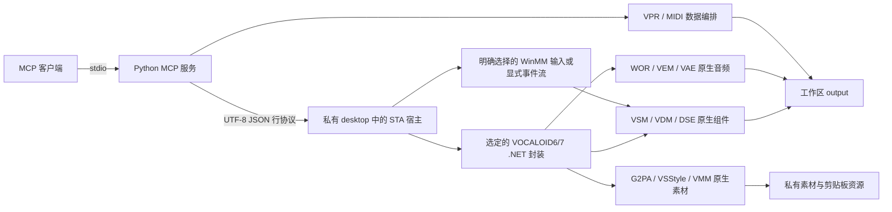

# 架构

## 进程边界

`install.py` 按注册表、标准目录及核心 DLL 文件版本选择安装；显式目录覆盖优先。每次创建宿主时选择并绑定产品、目录、版本，握手再次核对。V6/V7 的 .NET 10 构建输出分别位于 `native/bin/Release/<product>/net10.0-windows`，中间目录也按产品隔离。构建标记包含目标身份与宿主摘要，缺失或失配不启动旧构建。活动宿主不会重新发现并切换引擎；关闭后下一次启动才重新选择。

V7 的参数所有权由片段迁移到轨道，`V7Compatibility.cs` 显式区分两版原生 API，`MediaCompatibility.cs` 对 V7 缺失的 VMM 路径返回不支持。V7 原生音符使用 G2PA 类型化 getter，工程设置通过共享工厂创建。打开、克隆及导入时仅为空 VoiceTypeID 的 AI 轨初始化同声库默认类型；渲染入口校验声库和类型。详细边界见 [V7 兼容说明](vocaloid7.md)。下文历史 V6 的效果、素材及完整功能证据不自动延伸到 V7。

客户端通过各自的用户级配置启动同一 Python 入口。VS Code Stable/Insiders 使用 `servers`，Claude Code/Desktop 使用 `mcpServers`，Codex 使用 `mcp_servers`。绝对路径及显式 `PYTHONPATH`、`VOCALOID_WORKSPACE` 使启动不依赖客户端当前目录。不同客户端持有独立 MCP 进程；生成文件仍统一限定在本项目的 output。当前工作区配置保留。

Python 使用 Win32 `CreateDesktopW` 创建私有 desktop，以 `STARTUPINFO.lpDesktop` 启动原生宿主。宿主不实例化 WPF Application 或 MainWindow，也不运行编辑器的图形启动入口。不存在切换到用户桌面的分支。

启动前创建匿名管道与 Job Object；宿主先以挂起状态创建，加入 kill-on-close Job 后继续执行。任何隔离或进程归属设置失败都会终止启动，不换用普通桌面。

Windows CLR 会锁定正在运行的 DLL；宿主从 `.runtime/hosts` 下本次会话独有的完整构建副本启动，关闭后删除副本。构建输出不再被活动宿主直接加载，此机制不改变后端或程序集内容。

VSM 管理器使用每宿主唯一的 `VocaloidBridge-<GUID>` 缓存命名空间，而 VDM/DSE 继续读取原安装数据。固定使用编辑器的 `VOCALOID6` 命名空间会使一个管理器退出时删除其他宿主的 WAV 缓存；双宿主回归已复现该问题，因此缓存隔离与 desktop 隔离同时执行。`vocaloid_status.cache_namespace` 返回实际命名空间。

管理器的 `CacheCapacity` 设为零并读回确认，状态返回 `render_cache_bytes=0`。这一独立设置修复已渲染片段切换 Robot 后复用旧声音的问题；没有清空其他会话缓存，也没有改回共享命名空间。同宿主双会话的音频保留有定向验证。

## 临时文件清理（0.28.0）

MCP 进程启动时创建一次进程内清理线程，之后每 10 分钟重复。清理范围限定为 `output/`、`.runtime/mcp-temp`、`.runtime/tmp/VocaloidBridge-<guid>` 和同名 `.stderr.log`，以修改时间超过 1 小时为界。宿主临时命名空间只有在对应 stderr 日志可删除（说明宿主已退出）时才整树清理；仍在使用的文件由 Windows 共享冲突保护并记为保留。reparse point、`output` 之外的工程原件和 `.runtime` 的其他数据不参与。删除不回滚，回执写入 `.runtime/temp-cleanup/last-report.json`，并由 `vocaloid_status.temp_cleanup` 返回。`tools/clean_temp_output.py` 提供同一实现的手动 dry-run/apply 入口。

## 原生状态

每个会话持有真实 `WIVSMSequence`。对象引用限定于所属会话；删除性操作使子引用失效，关闭会话清理所有引用。所有原生方法在宿主同一 STA 线程顺序执行。

新建、打开、保存和关闭直接使用 VSM 方法。保存由引擎写出工程目录，再封装 VPR；原始输入和临时文件分离。乐谱编排使用 VPR 结构化数据，原生打开是独立且必要的验证步骤。文件级读改写在 Windows 上以同一个只读源句柄贯穿序列读取和资源复制，期间阻止冲突写入或替换；调用者自行传入的 `write_copy` 数据不带来源版本保证。文件级 AI 音符通过完整源快照与索引显式选择身份，未选择的输入是新音符；音素 sidecar 引用还须保持原索引，受审查扩展项目的文件音符替换保持保护。文件级 JSON Patch 在私有副本上跟踪带无效音素 sidecar 的音符对象：移动更新索引，复制产生独立条目，删除或替换移除旧条目；歌词、音素或语言变更仍由原生编辑处理。文件级 tempo/控制曲线替换按源 tick 保留对应事件未知字段，新 tick 不继承其他事件字段，重复源位置在创建输出前拒绝；这不是原生对象身份或历史事务。

`vocaloid_bridge/compose.py` 为 `score_compose` 与 `score_replace_notes` 的缺省 AI 音素创建临时 VPR 和私有原生会话：验证实际安装声库及语言，调用 G2PA，核对完整单音节、候选、相邻音符及原生加载；空候选使用两个不同的编辑器默认音素种子比较结果。转换前核对音素 sidecar 引用，成功后从持锁源归档生成候选，使用同卷硬链接独占发布并重新打开核对；失败时关闭自有会话并移除临时候选。目标路径已存在时不覆盖；进程崩溃持久性、其他声库和发音质量未由该流程保证。`score_compose` 返回打开的最终会话，`score_replace_notes` 在验证后关闭会话并仅返回文件信息；无待转换音符的替换仍为纯文件写入。

原生写入器会省略未知 JSON 字段与额外 ZIP 成员。`ProjectArchivePreservation.cs` 从安装版 schema 识别字段，将受支持的未知字段绑定到原生 track/part/note 对象身份并监听生命周期；真实提交、撤销、重做、回滚同步实体、root/master、速度/拍号/控制器事件和资源映射快照。速度与拍号扩展按明确的原生操作映射，不依赖旧数组索引；受测速度地图合并按 tick 建立映射，拍号合并在独立候选中逐事件复现原生小节换算。控制器扩展支持受测的直接编辑、轨道/片段复制、拆合与历史；原生生成的边界点不继承未知字段，跨工程迁移现已核对原生重复对象、完整数值和坐标偏移。提交前校验受跟踪曲线，未建立对应关系时在事务内回滚。保存只向全新的原生 JSON 叠加未知叶子，已知字段仍由当前引擎写出。扩展剪贴板粘贴和工程合并先在独立候选中执行并验证原生保存；剪贴板轨道、片段或音符选择均携带整份工程级不透明资源，音频轨及片段的原始/处理 WAV 迁移已有受测样本，并检查实际 ZIP 的条目与解压大小限制。剪切不按实体归属删除工程级资源，异常时保留快照；其他复杂数组和音频组合仍有保护边界。扩展工程的原生合成、MIDI 导出和离线混缩使用独立原生快照并返回源会话 ID；外部 WAV 离线处理及受测私有素材操作不修改工程。候选预检增加工程复制和原生保存开销，资源私有副本保留至会话关闭。

打开时以已安装程序集目录作为原生 `vsqxSchemaDirPath`。`ProjectIntegrity.cs` 在载入前检查已知的经典声库缺失条件，在载入后核对轨道类型、数量、片段数与输入的显式声库身份；保存和克隆则先核对原生输出与当前会话的非空主/副声库及根 voices 表，再发布或打开副本。失败不替换已有目标，不用桥接元数据伪装原生声库。原生 Save 自身可能更新内部修改标志，检查不承诺整个引擎内部完全无副作用。

结构化编辑使用原生事务，提交后重新取得对象并核对修改。仅传相同的名称、颜色、静音、独奏和总线字段组合时，`track.update` 在检查无暂存变更后保持原有脏状态；包含 `midi_recording` 的请求保留原生 setter 路径。直接音高通过音符的 `SetDirectPitch` 写入，不依赖交互式绘线状态；局部清除把桥接的半开区间转换为原生闭区间，并在提交前后核对剩余点。原生格式交换负责导入、MIDI 导出、复制、恢复和合并；导入资源保留到目标会话关闭。无其他原生变更且不涉及 tempo/拍号扩展事务的受测纯元数据合并，在同一事务内暂存并恢复初始速度，从而把归档字段和资源纳入真实原生撤销历史，最终速度保持不变。私有剪贴板持有独立原生快照，不读写系统剪贴板，源工程关闭后仍能粘贴。

受测 AI 工程的 `directPitches` 项未知字段绑定到所属原生音符，并按明确的选中 tick 策略处理 upsert、replace 和 clear；音符、片段及轨道复制使用原生返回对象及唯一语义签名映射，并深拷贝字段；轨道属性/重排和片段属性/移动在提交前核对原有音符身份及点集，同形片段目标在修改前拒绝。0.24.0 的删除绑定完整父关系图与选中后代，拆合按明确的音高轨迹来源核对数值和坐标，跨工程路径深拷贝字段并核对新对象；冲突回滚。MIDI/AI 扩展时间编辑先在独立原生候选上执行和序列化，再核对实际事务中的实体身份；时间插入按安装版托管实现预测扩展速度/拍号事件的一对一移动并核验原生对象，时间删除在受测范围内映射保留的 tempo/拍号身份，删除事件的字段随之删除，原生新生成 tempo 及受测未占用位置的拍号边界不继承字段；拍号起始位置碰撞保留目标原生事件身份及原字段，并验证更新后的拍号。音频、控制器、音高项、主音量项及轨道自动化项扩展时间编辑继续保护。速度合并的碰撞位置由源事件及其字段覆盖，完整结果须与原生地图一致。主音量事件扩展按明确选定的 tick 与当前原生值映射，事务快照随原生历史恢复，保存只覆盖未知字段。 轨道音量/声像项扩展绑定所属原生轨道及完整点集；受测选点编辑、轨道属性/重排和历史保留身份，跨工程迁移已按非零点偏移核对完整地图，其他未验证变更继续保护。

`vocaloid_operations` 从随包发布的结构化目录提供全部操作名称、所属工具与文档契约；目录由原生 dispatch 和相关 Markdown 的操作首列精确匹配生成；每个操作都必须有契约行，缺失时生成检查报错。使用 `tools/generate_operation_catalog.py --check` 检查漂移。目录仅代表调用面，实测状态仍由功能矩阵记录。

当前为 41 工具、130 操作。`vocaloid_features` 提供按产品区分的功能与参数模板，V6 历史矩阵显式标记版本。`project_inspect` 根据功能及明确的目标索引读取真实原生状态和范围，不执行修改。V7 轨道身份指纹包含主/副声库 compID，加载时再核对原生值，避免不同声库的同形轨道被误判；真正身份冲突继续拒绝。

`project_ai_adjust` 编排 `ai.status`、可选整轨 Take 设置及 `ai.generate`。`V7AiOperations.cs` 在会话所属 STA 上使用既有原生渲染器生成缓存，临时 WAV 检查后删除，不经过用于交付导出的独立归档快照，也不假称导出音频。默认核对原有直接音高逐点不变；请求保留时，全部选中音符在一个 `ScoreMutate("pitch.set")` 事务内固化，复用数组身份检查与撤销历史。已有点的覆盖授权在生成前检查。生成完成观察与提交后的当前缓存状态分开返回。

V7 的 Robot 轨道便利 setter 会补全脚本并访问交互编辑器的 `App.SequenceManager`。后台宿主直接调用原生 Robot 效果 setter，再用自有管理器准备脚本，避免初始化编辑器 App。该路径及扩展工程 AI 生成/音高固化的真实证据见会话46。

## 人声合成

合成前始终调用原生 `Commit(false)`。该调用除了提交编辑，还负责刷新渲染队列；即便序列没有暂存编辑也不能跳过。无暂存编辑且原生错误为 `NoError` 时，Commit 返回 false 不代表失败。

启用 Robot Voice 时，宿主使用安装的 Lua 管理器和原生效果对象恢复相应脚本路径与渲染时序。路径属于运行时状态，不保存在 VPR；片段合成和整曲混缩均在提交渲染队列前恢复，不初始化编辑器 App。

传统片段的 Singing Skill 同样按已安装目录解析 plugin ID，并在渲染前恢复原生脚本与时序；请求不接受任意脚本路径。音符级 HMM 权重另有独立入口，不与 Singing Skill MIDI 效果混为一谈。

宿主设置 Lua 控制器和渲染观察者，启动原生异步渲染，并在同一 STA 线程轮询原生观察者。只有目标片段具有有效波形，且 `Sequence.IsFinishedRendering` 为真后，才停止队列、释放控制器并检查 RIFF/WAVE、发布到 output。目标片段的完成事件不能代替整个队列完成；提前停止会使其他片段停留在部分渲染状态，后续混缩可能超时。因此单段导出也会等待同一序列已排队的其他片段完成。返回 `render_observation` 记录开始、完成和进度；Python 再检查实际音频帧、峰值和 RMS。原生等待上限为 120 秒，外层 RPC 为 180 秒，不通过声卡播放或 UI 渲染。内部声乐合成限定 44100 Hz；混缩输出采样率独立设置。12 段工程修复前后证据见 [会话 37](session-log/session-37.md)。

## 音频与素材

离线反转、规范化、拉伸、移调和变声使用 WOR。VAE 以明确的 VST 主机连接方式初始化，再进入 Manual 模式，通过文件片段和 VEM 完成整工程/整轨混缩；不启动播放或选择物理设备。分轨保留轨道/片段效果并旁路主效果和主音量自动化。自定义秒区间和尾长参数明确拒绝。

独立的传输分支使用用户明确选择的设备 ID 和 VAE StandAlone 模式，不改系统默认设备或用户编辑器。一个宿主最多持有一个准备好的传输；扩展工程使用原生私有快照并将传输身份绑定原会话，释放前保护对应会话和共享效果管理器，关闭先释放设备、回调及快照。`SetCurrentTime` 的异步应用与已观测位置分开返回，静音设备测试验证了时钟推进、停止、定位及释放。

`MidiRecordingOperations.cs` 通过 System32 的 WinMM 接口枚举输入，只有明确给出设备 ID 与名称才打开；另有调用者显式提交的事件流模式。设备回调仅入队或记录错误，所有 VSM 访问仍由宿主 STA 线程完成；无效输入、回调故障或队列溢出时停止提交。停止时按工程速度映射转换并在事务中写入。可选的本会话 transport 同步在停止时先释放设备传输再提交。录制期间保护工程、库和剪贴板写入；关闭或退出先释放输入。事件流、静音同步、回调逻辑及自有虚拟输入的 WinMM 回调已验，物理硬件输入和实际驱动错误通知未验，详见 [MIDI 录制](midi-recording.md)。

编辑器官方不具备波形录音功能，录制 WAV 后由现有音频导入入口接收。安装的 VST3 插件已有固定管道名路径的静态证据，私有 desktop 本身不证明跨进程 IPC 隔离；尚未加载插件或验证 DAW 同步，详见 [音频录制与宿主边界](audio-recording.md)及 [DAW IPC 调查](daw-ipc.md)。

`TrackFreezeOperations.cs` 先生成原生轨道混音，再按首片段起点减预送时间物化自有 WAV。冻结放置范围覆盖全部片段；回放不重复套用已烘焙的轨道音量/声像。冻结前保存真实效果旁路值，序列化时恢复到作者状态；原生冻结标志不持久化。解除冻结的原生调用会删除 WAV，因此入口只接受该会话登记的私有路径。

G2PA、样式和 VMM 素材服务按需初始化，并在宿主退出时释放。AI `note.add` 使用指定声库、编辑器默认种子和原生 G2PA 验证完整单音节及相邻音符，不再依赖已有音符。歌词/音素应用和重置检查无既有暂存后进入原有乐谱事务，成功写入撤销历史，受测提交前失败恢复音符、dirty 和原有历史。提交后读回和原生提交/回滚失败不由该样例保证。自有媒体位于 `.runtime/library`；修改和删除只允许该私有目录。VMM 的属性保存在 `property.json`，音符资源保持独立。`MediaPropertyOperations.cs` 在独立原生子进程中写副本，只回填请求字段。`MediaPropertyJournal.cs` 以工作区级互斥串行素材访问，使用独占文件句柄、持久原文/候选快照和禁止覆盖目标的重命名发布；原生读回后写提交标记。下次素材访问回滚未提交日志、清理已提交日志并重新加载缓存。外部冲突保留双方数据，物理断电及损坏不由进程中断测试保证。原生 Attack/Release 通过已安装数据库的组件 ID 和级别名称映射。

AI MIDI 素材可在自有 `.vsclip` 中附带受测片段及音符未知字段，按片段与唯一音符身份绑定。导入时先验证路径只指向未知原生字段，在只读锁内以独立原生候选验证序列和归档覆盖，再重新取得原生素材/轨道对象并在事务中修改目标。控制器扩展素材和扩展工程音频写入继续由独立守卫保护。直接效果器修改进入原生撤销历史；样式应用将 MIDI 参数、音频效果和样式身份统一暂存后提交，扩展工程复用实体与数组保护，一次撤销恢复完整状态。

原生 VSStyle 捕获、覆盖、属性编辑和删除仅写入 `.runtime/library/styles` 中的自有样式文件；系统样式和原有用户样式只读。捕获直接复制原生 MIDI／音频效果参数，随后在原生事务中把样式名及 ID 写回来源声部，保存工程后持久化。该工程事务可撤销，但不撤销独立的预设文件。`performance.set` 修改 Robot、Breath、Take 或 VoiceColor 参数时默认解除对应旁路；同次请求的显式旁路设置优先，不改变其他效果。

音频素材捕获依据原生区域和工程速度映射，在私有 `audio-sources` 中物化选定的 WAV 采样；原件保持不变。此路径保留采样格式与数据，不承诺保留 WAV 的所有附加元数据块。

VMM 的原生素材写入器保存次声库字段，但当前读取器返回空值。桥接层对原生 `.vsclip` 使用 JSON 解析补充该字段、标注数据来源并检查非空冲突；人声合成仍只使用安装的原生引擎。

原生 VMM 不持久化无效音素标志或 AI Attack/Release；新建自有 `.vsclip` 将它们放在 `vocaloid_bridge_phoneme_validity_v1` 扩展中，导入时核对音符身份与已安装数据库。原生 VPR 也不持久化无效音素标志，桥接层以 `vocaloid_bridge/phoneme-validity-v1.json` 保存，打开和复制时恢复。文件级 VPR 编辑保留该条目，但会拒绝使引用音符不匹配的修改；这些扩展不声称被其他软件保留。

公开 PPSF V2 与 VSQX3/4 样本的原生导入保留了音符数据，但当前缺经典 DSE 声库时，保存会丢失经典身份，载入也有强制 AI 分支。该分支已定位到安装版本的 VSM 数据库计数路径；保护检查对此明确报错，经典合成与无损往返保留为环境依赖。用户选择仅使用 AI 声库，不安装经典试用。作者公开 PPSF3.2 则已完成 190 音符的原生导入、保存与重开；NT 声库不等同本机 VOCALOID 声库。

验收客户端记录前台窗口及所属 PID，区分用户正常切换和测试进程抢焦点，不恢复或激活窗口。上轮整合为 76 通过、5 失败、2 个缺样本项；本轮定向修复与复查分开保留回执。`project_render_part` 返回原生 `lua_result`，`NoError` 本身不构成效果证据；Robot、Take、Breath 与三个 AI VoiceColor 参数已另有实际 PCM 差异。VoiceColor 的当前轨道适用性另行返回，存储非适用字段不代表合成器使用了它。覆盖范围以功能矩阵逐项状态为准。

## 边界

MCP 不暴露任意进程调用、内存地址、脚本执行、授权数据或图形窗口命令。原生错误原样转换为协议错误，不使用静音文件、旧音频、其他音源或 UI 操作掩盖失败。

运行时子进程的 `TEMP` / `TMP` 指向工作区 `.runtime/tmp/<private-desktop>`，退出后检查归属再清理。原生管理器成功释放后只删除所选产品 `LOCALAPPDATA/<product>/VSM` 和 `VSMCaches` 内自身 GUID 命名空间；历史清理按回执和进程创建时间判断，保留活动及无证据目录。取消或读取故障会关闭自有连接，保留未知结果错误，不自动重放请求。

## 0.24.0 补充

素材冲突决策由独立的工作区操作暴露，过期 revision 拒绝，持久决定先于恢复写入，归档保留双方原文。素材属性在完整 clip 字节不变的条件下支持归档元数据。扩展工程音频导入、编辑和效果操作复用原生事务；歌词在提交前验证完整短语和未选择字段。完整契约和边界见 [Agent 功能补齐](agent-completion-33.md)。

## 0.25.0 剩余实现

`ProjectArchiveTimeEdit.cs` 替代旧时间守卫，使用原生拆分、移动、删除和已安装时间算法完成单次事务；音频身份包含 region。`ProjectArchiveNestedArrays.cs` 为所属实体中的其他对象数组保存自然键、已知投影和未知字段，在原生暂存快照上核对后提交。素材元数据 v2 支持控制器、音高及音频，素材导入和效果同事务；旧 v1 保持可读。读回异常在提交前回滚，纯元数据地图合并建立原生历史。详见 [完整契约](completion-34.md)。

## MCP 托管进程生命周期（0.26.0）

Python MCP 服务按需启动独立 VOCALOID 宿主，首次握手记录缓存命名空间。`vocaloid_runtime` 管理启停和代次，默认检查活动工程数。已确认退出的实例允许新建/打开请求启动新代次；旧句柄明确过期。派发后连接中断报告未知结果，不重放修改。该机制不负责 Codex 到 MCP 的宿主工具绑定。详见 [生命周期契约](runtime-lifecycle.md)。

## Agent 作曲流程与适用性（0.27.0）

`vocaloid_workflow` 原样返回 `docs/song-workflow.md`，`vocaloid://workflow` 资源和 `write_song` 提示指向同一份内容；服务说明和各工具说明只保留一行必要规则，如 tick 精度、歌词写法和 44100 Hz 工程。`vocaloid_operations` 不带范围索取全部文档时报错，避免超出客户端的单次结果上限。

原生端在同一乐谱事务内处理 AI 音符改词：`lyric` 或 `lyric` 加 `lang_id` 变化且未给音素时，像新音符一样重置种子并走已验证的单音节转换，拒绝时整体回滚；受保护音符、显式音素和标准声部音符不转换。歌词被拒绝的报错按语言给出可接受的写法。`controller.types`、`dvqm_get` 标注适用声部，`vibrato.get` 返回类型名和取值范围，`voice.get/set` 附已安装声库的名称与语言。

适用性依据是 `tools/check_ai_effect_audit_36.py`：同一 AI 短语每次从保存的工程重新打开、施加一项控制后渲染，与基线逐样本比较。它衡量某项控制是否改变合成结果，不评价音质，也只用 asa 测过。
